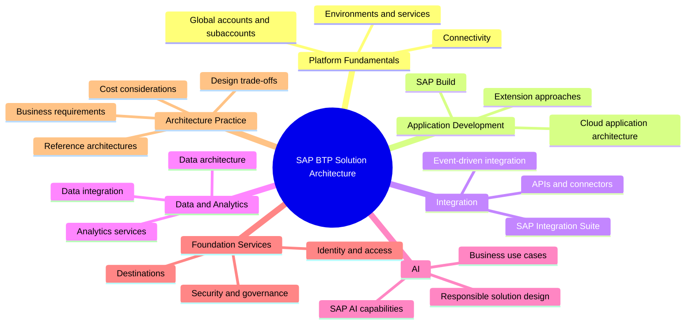
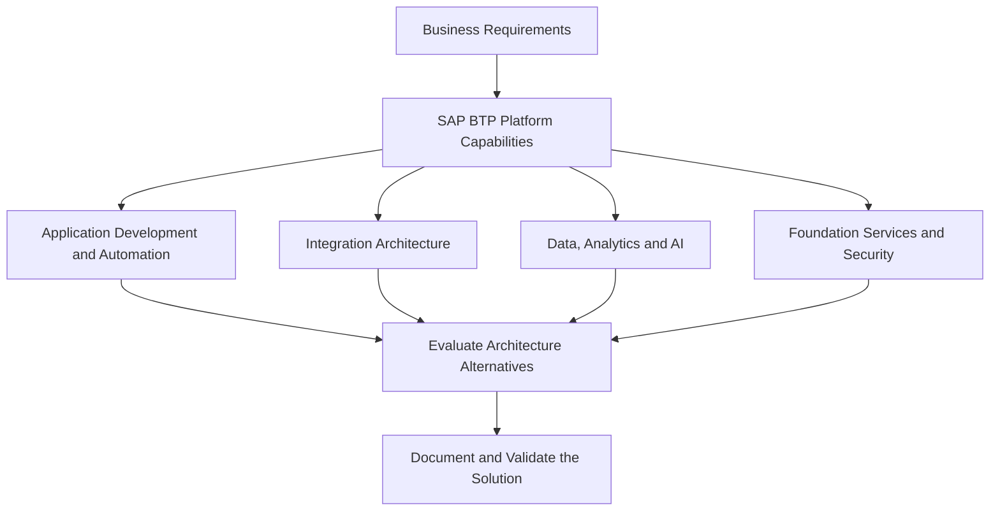
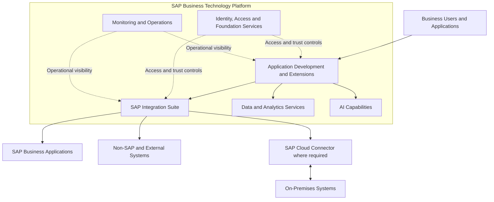
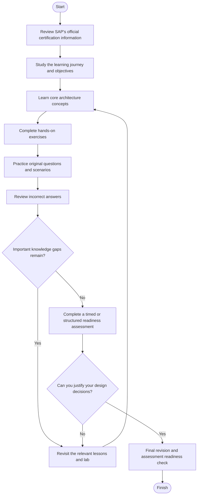
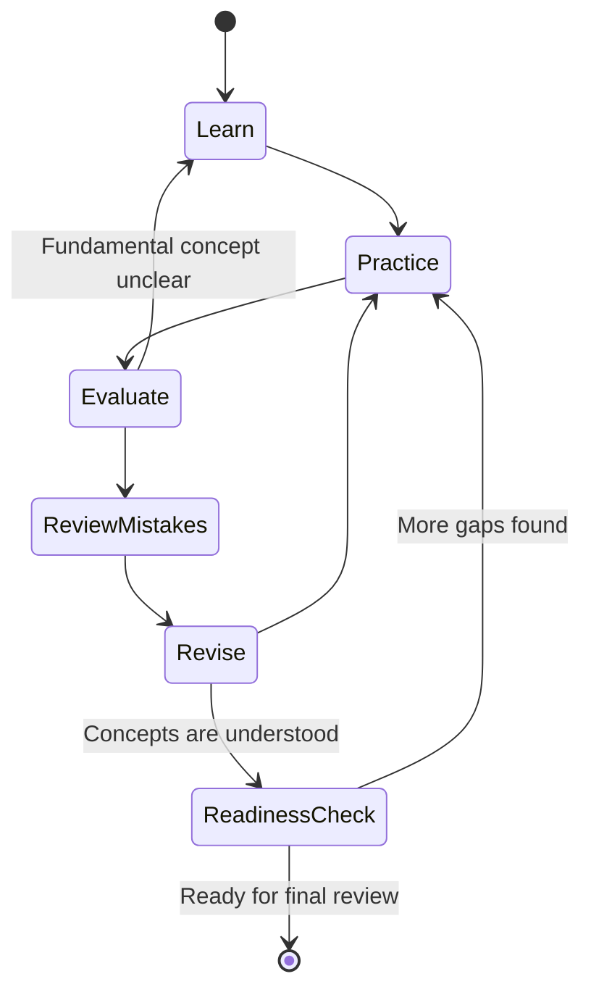
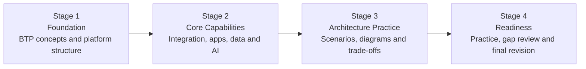

# SAP BTP Solution Architect — P_BTPA Study Guide

A practical, community-oriented study guide for the **SAP Certified – Solution Architect – SAP BTP (P_BTPA)** certification. This repository helps learners organize their preparation around enterprise architecture, SAP Business Technology Platform services, integration strategy, application development, data and analytics, security, and solution design.

The guide complements SAP's official learning materials with architecture diagrams, a study roadmap, practical exercises, and original practice scenarios.

## Table of Contents

- [Overview](#overview)
- [About the Certification](#about-the-certification)
- [Who Should Prepare?](#who-should-prepare)
- [Skills and Knowledge Areas](#skills-and-knowledge-areas)
- [Official Exam Objectives and Weightings](#official-exam-objectives-and-weightings)
- [SAP BTP Architecture at a Glance](#sap-btp-architecture-at-a-glance)
- [Certification Preparation Flowchart](#certification-preparation-flowchart)
- [Circular Study and Revision Cycle](#circular-study-and-revision-cycle)
- [Step-by-Step Preparation Guide](#step-by-step-preparation-guide)
- [Study Roadmap](#study-roadmap)
- [Practice Questions and Scenario Exercises](#practice-questions-and-scenario-exercises)
- [Hands-On Projects](#hands-on-projects)
- [Common Preparation Mistakes](#common-preparation-mistakes)
- [Career Relevance](#career-relevance)
- [Frequently Asked Questions](#frequently-asked-questions)
- [Official and Additional Learning Resources](#official-and-additional-learning-resources)
- [About CertsGate](#about-certsgate)

## Overview

SAP Business Technology Platform (SAP BTP) provides capabilities for application development, automation, integration, data management, analytics, artificial intelligence, and enterprise application extensions. A solution architect needs to understand how these capabilities fit together to address business and technical requirements.

Preparing for the P_BTPA certification is therefore more than memorizing service names. The important skill is learning how to evaluate a business problem, identify suitable architecture patterns, select relevant SAP BTP capabilities, and explain the trade-offs behind a proposed design.

Use this repository as a structured companion to SAP's official learning journey:

**[Becoming an SAP BTP Solution Architect](https://learning.sap.com/learning-journeys/becoming-an-sap-btp-solution-architect)**

## About the Certification

The **SAP Certified – Solution Architect – SAP BTP** certification is intended for professionals developing solution-architecture knowledge around SAP Business Technology Platform.

SAP's learning journey focuses on using BTP to envision and design enterprise architecture, align IT strategies with business objectives, and evaluate technologies and costs for potential use cases.

| Item | Information |
|---|---|
| Certification provider | SAP |
| Certification name | SAP Certified – Solution Architect – SAP BTP |
| Exam code | P_BTPA |
| Catalog version | P_BTPA_2511, as listed by CertsGate |
| Main focus | SAP BTP solution architecture |
| Recommended starting point | SAP's official solution architect learning journey |
| Assessment details | Check the current SAP certification page and exam instructions |

SAP's certification format and assessment policies can evolve. Do not rely on an older exam description, reported question count, passing score, or time limit without checking the current official information.

## Who Should Prepare?

This study guide is especially relevant to:

- SAP solution and enterprise architects designing cloud and hybrid landscapes.
- SAP consultants who need to explain architecture options to project teams and customers.
- Integration specialists working across SAP and non-SAP applications.
- Developers moving toward architecture and technical-design responsibilities.
- Technical leads evaluating application extensions, data services, automation, and AI capabilities on SAP BTP.

SAP lists **BTP100 – Discovering SAP Business Technology Platform** and practical SAP BTP experience as prerequisites for its solution architect learning journey. Review the [official learning journey](https://learning.sap.com/learning-journeys/becoming-an-sap-btp-solution-architect) for the latest prerequisite guidance.

If you are new to BTP, begin with platform fundamentals before moving to architecture patterns and design decisions.

## Skills and Knowledge Areas

Use the following topics as a **conceptual study map**, based on the areas covered in SAP's solution architect learning journey. This is an independent preparation overview, not an official exam-domain list or weighting.

### 1. SAP BTP fundamentals

Understand the platform's purpose, account structure, environments, service consumption, and the relationship between BTP and the SAP applications it supports.

Be able to explain why an organization might use BTP to extend existing applications instead of adding unnecessary customizations to the core system.

### 2. Application development and automation

Study the application development and automation capabilities relevant to the architecture use case. Understand the difference between building an application, automating a process, and extending an existing SAP application.

Focus on selecting an appropriate approach rather than assuming one service fits every requirement.

### 3. Integration architecture

Learn how to connect SAP and non-SAP systems through APIs, integration flows, connectors, and event-based patterns. Understand the purpose of SAP Integration Suite and the role of monitoring, authentication, mapping, and error handling.

### 4. Data and analytics

Explore how data is integrated, governed, and made available for reporting and business decisions. Evaluate data and analytics services in the context of the problem being solved, not just by their feature lists.

### 5. AI and foundation services

Review SAP's AI-related capabilities alongside the platform's foundation services. Consider identity, connectivity, security, operational needs, and governance when designing a complete solution.

### 6. Architecture methods and cost considerations

Practice translating business requirements into architecture diagrams. Compare alternatives, document assumptions, identify dependencies, and consider operational complexity and cost.

## Official Exam Objectives and Weightings

SAP's [official solution architect learning journey](https://learning.sap.com/learning-journeys/becoming-an-sap-btp-solution-architect) is the primary starting point for preparing for P_BTPA.

The journey includes material on:

- SAP BTP capabilities and architecture.
- Application development and automation services.
- Data and analytics services.
- Integration services and integration strategy.
- AI services.
- Foundation services.
- Reference architectures and architecture guidance.

The list above summarizes learning content; it should not be interpreted as a complete, formally published exam blueprint.

**No official domain percentages are assigned in this guide.** Confirm whether SAP provides a current exam-specific objective list or assessment guide before treating any topic as more heavily weighted than another.

For planning purposes, use the following conceptual view instead of an invented percentage chart:

This diagram illustrates how architecture topics can connect during solution design. It is not an official SAP exam-domain diagram.

## SAP BTP Architecture at a Glance

A solution architect should be able to explain how platform services connect applications, manage access, and support communication between cloud and on-premises systems.

The following is an **illustrative architecture**, not a prescribed or universally applicable SAP reference architecture.

### How to interpret the diagram

- **Application development and extensions:** Deliver user-facing functionality or extend existing business capabilities.
- **Integration Suite:** Supports integration between applications and services using suitable integration patterns.
- **Data and analytics:** Supports data-related use cases and business insight.
- **AI capabilities:** Support selected AI-related use cases when they fit the business requirements.
- **Identity and foundation services:** Help establish secure access, connectivity, and other platform capabilities.
- **Monitoring and operations:** Provide visibility into service behavior and operational issues.
- **Cloud Connector:** Can provide controlled connectivity between SAP BTP and on-premises systems when required by the design.

The services selected for a real solution depend on its requirements, supported deployment options, security constraints, and cost model.

### Architecture decisions to practice

When evaluating a design, ask:

1. Is the solution extending an existing application or creating a separate application?
2. Does the integration require synchronous APIs, asynchronous messaging, event-driven communication, or data replication?
3. Which systems own the data, and how should access be controlled?
4. Are any systems restricted to private or on-premises networks?
5. What are the availability, monitoring, compliance, and recovery requirements?
6. Which services are necessary, and which would add avoidable complexity or cost?

## Certification Preparation Flowchart

Use this preparation process to make progress measurable. If a practice exercise reveals a knowledge gap, return to the relevant learning material before moving forward.

The purpose is not to complete each step once and move on. Architecture knowledge improves when you repeatedly apply concepts, identify gaps, and refine your reasoning.

## Circular Study and Revision Cycle

Architecture questions often have multiple plausible answers. Repeating the learning cycle helps you understand why a solution fits the requirements and why alternatives may be less suitable.

Use the cycle as a continuous process:

- **Learn:** Study the concept in SAP's documentation or learning material.
- **Practice:** Apply it to a design problem or hands-on exercise.
- **Evaluate:** Check whether your proposed solution meets the requirements.
- **Review mistakes:** Identify incorrect assumptions or missing constraints.
- **Revise:** Return to the relevant lesson and improve your understanding.
- **Practice again:** Confirm that you can apply the concept in a different scenario.

## Step-by-Step Preparation Guide

### Step 1: Establish your baseline

Read the current SAP certification information and open the official solution architect learning journey. Note the assessment requirements, prerequisites, and any guidance that applies to your certification attempt.

Assess your existing experience with SAP BTP, integration, cloud architecture, and application design.

### Step 2: Learn platform fundamentals

Review the structure and capabilities of SAP BTP. Understand how accounts, environments, services, connectivity, and identity relate to a working solution.

Do not simply memorize product definitions. Practice explaining when a capability is useful and what problem it solves.

### Step 3: Work through the learning journey

Study the units covering application development and automation, data and analytics, integration, AI, and foundation services. Create a short summary for each topic that includes its purpose, common use cases, dependencies, and design considerations.

Use SAP's architecture guidance and reference architectures where appropriate.

### Step 4: Compare design alternatives

For each business requirement, identify at least two possible approaches. Explain the benefits, limitations, security implications, and operational trade-offs of each.

For example, an integration scenario involving a private on-premises system may require a different connectivity approach from one involving only public cloud APIs. The right design depends on network boundaries, supported services, and security requirements.

### Step 5: Build and inspect a small solution

Where you have access to a suitable SAP BTP learning environment, configure or inspect a simple application or integration. Trace its authentication, connectivity, data flow, and monitoring requirements.

Record what worked, what failed, and which documentation helped resolve the problem.

### Step 6: Practice scenario-based reasoning

Use original scenarios and practice questions to check your understanding. After each answer, explain why it fits the stated requirements and why another plausible option would not.

Map mistakes back to the relevant learning material rather than repeatedly answering the same question from memory.

### Step 7: Check readiness

Before your assessment, confirm that you can:

- Explain core SAP BTP architecture concepts without relying on notes.
- Select suitable capabilities for common business scenarios.
- Describe integration and connectivity trade-offs.
- Account for security, identity, monitoring, and operational requirements.
- Explain the assumptions behind a proposed solution.
- Navigate the current official assessment instructions confidently.

## Study Roadmap

This four-stage roadmap is a suggested study structure, not an official SAP schedule. Adjust the duration to your experience and access to practical environments.

| Stage | Main work | Suggested output |
|---|---|---|
| 1. Foundation | Review BTP fundamentals and prerequisites | A platform concept map |
| 2. Core capabilities | Study the official learning journey | Notes grouped by topic |
| 3. Architecture practice | Analyze use cases and compare designs | Two or three solution diagrams |
| 4. Readiness | Practice scenarios and revisit weak areas | A personal gap checklist |

### Example weekly plan

| Session | Activity |
|---|---|
| Session 1 | Study one learning-journey topic |
| Session 2 | Summarize the concepts and review official documentation |
| Session 3 | Work through a relevant practical exercise |
| Session 4 | Draw an architecture and explain the design choices |
| Session 5 | Answer practice questions and review mistakes |
| Session 6 | Revisit weak topics and repeat a scenario |
| Session 7 | Review progress and plan the next study cycle |

This is a flexible template. It is not a prediction of how long any individual will need to prepare.

## Practice Questions and Scenario Exercises

Practice questions are useful when they reveal gaps in your reasoning. They are less useful when you memorize answer patterns without understanding the architecture behind them.

For P_BTPA preparation, combine conceptual checks with short architecture scenarios. The following examples are **original learning exercises**, not official SAP exam questions.

### Scenario 1: Connecting an on-premises application

An organization wants an application running on SAP BTP to communicate with a system hosted inside its private network. Direct inbound access to the private system is restricted.

**What should the architect investigate?**

A. Whether the system can be exposed publicly without additional controls.  
B. Whether SAP Cloud Connector and the required BTP connectivity configuration fit the network and security requirements.  
C. Whether all data should first be moved to a spreadsheet.  
D. Whether monitoring can replace authentication.

**Discussion:** Option B is the most relevant starting point. The architect must validate the actual connectivity requirements, supported setup, and access controls rather than assume that a public endpoint is appropriate.

### Scenario 2: Integrating multiple applications

A business needs to exchange information between SAP and non-SAP applications, transform messages, and monitor failed integrations.

**Which capability should be evaluated first?**

A. SAP Integration Suite and the integration patterns relevant to the use case.  
B. A visual theme for the application.  
C. A reporting dashboard unrelated to the integration.  
D. A manual export process as the only long-term design.

**Discussion:** Option A is the logical starting point because the requirements concern application integration, message transformation, and operational monitoring. The final design still depends on protocol, data, latency, and deployment constraints.

### Scenario 3: Choosing an extension approach

A project team wants to add functionality to an existing SAP application while keeping the core system maintainable.

**What should the architect consider?**

- The business capability being added.
- Supported extension patterns and the relevant SAP guidance.
- Dependencies, identity, integration, and lifecycle management.
- The effect of the proposed design on upgrades and ongoing operations.

**Discussion:** A sound architecture starts with requirements and supported extension options. Avoid selecting a service before understanding the business need.

### How to review your answers

After every exercise:

1. Identify the requirement that drives the design.
2. Explain why your proposed option addresses it.
3. Identify assumptions that would need confirmation in a real project.
4. Compare at least one alternative.
5. Link the mistake or uncertainty to a specific learning resource.
6. Revisit the scenario later and solve it without referring to your previous answer.

For additional preparation material, you can also explore [CertsGate's SAP certification resources](https://certsgate.com/exams/sap). Treat third-party content as supplementary and verify technical or certification claims against SAP's documentation.

## Hands-On Projects

Practical exercises help connect abstract architecture principles to implementation details. Complete these only in an authorized learning environment and with appropriate access.

### Project 1: Draw a BTP extension architecture

**Goal:** Design a small extension for an existing SAP business application.

Tasks:

- Write down the business requirement and user roles.
- Identify the application components and relevant BTP capabilities.
- Document identity, connectivity, and data-flow assumptions.
- Draw the architecture in Mermaid or another diagramming tool.
- Explain why the selected approach is suitable.

**Deliverable:** A solution diagram and a one-page architecture decision record.

### Project 2: Design an integration flow

**Goal:** Plan how an SAP application exchanges information with an external system.

Tasks:

- Identify the source, target, data format, and communication pattern.
- Consider authentication and authorization.
- Document transformation and error-handling requirements.
- Identify how integration failures would be monitored and investigated.
- Explain how the approach changes if the target system is private or on-premises.

**Deliverable:** An integration sequence diagram and a checklist of security and operational considerations.

### Project 3: Compare two solution designs

**Goal:** Practice architecture trade-offs.

Create two possible designs for the same business requirement. Compare:

- Functional fit.
- Security and connectivity.
- Scalability and operational complexity.
- Integration and maintenance effort.
- Service dependencies and cost considerations.

**Deliverable:** A comparison table and a reasoned recommendation.

## Common Preparation Mistakes

### Memorizing product names instead of understanding their roles

Knowing the name of a service does not mean you understand when to use it. Learn its purpose, dependencies, limitations, and relationship to other components.

### Ignoring the business requirement

An architecture should solve the stated problem. A technically sophisticated design can still be unsuitable if it introduces unnecessary services or does not satisfy a key constraint.

### Treating every integration problem the same way

Different requirements may call for APIs, integration flows, asynchronous messaging, events, or other patterns. Evaluate latency, reliability, data volume, and system boundaries.

### Skipping practical work

Reading about an integration or application service is not equivalent to understanding its configuration and behavior. Use practical exercises whenever you have appropriate access.

### Trusting unverified exam claims

Question counts, passing scores, exam durations, and assessment methods may change. Check current SAP sources rather than relying on old posts or unverified third-party descriptions.

### Using practice tests as the only preparation method

Practice tests should expose weak areas. They should not replace the official learning journey, documentation, or technical reasoning.

## Career Relevance

SAP BTP architecture knowledge can support work involving:

- SAP solution architecture.
- Cloud and hybrid integration.
- SAP application extension.
- Enterprise application design.
- Technical consulting and solution planning.
- Data, analytics, and AI solution evaluation.

The certification can provide structured evidence of learning, but it does not replace practical experience, architecture judgment, or familiarity with the systems used in a specific organization.

## Frequently Asked Questions

### What is the P_BTPA certification?

P_BTPA is associated with SAP's **SAP Certified – Solution Architect – SAP BTP** certification. Check SAP Learning for the current certification details and assessment requirements.

### What should I study for P_BTPA?

Start with the official *Becoming an SAP BTP Solution Architect* learning journey. Its subject areas include platform fundamentals, application development and automation, data and analytics, integration, AI, and foundation services.

### Is there an official exam-domain weightage chart?

Do not assume that the topic groupings in this repository are official exam domains. Consult SAP's current certification materials for any published objectives or weightings. This README does not assign numerical weights.

### How long should I prepare?

Preparation time depends on your existing SAP BTP knowledge, architecture experience, and access to practical exercises. Use the roadmap as a flexible plan and progress based on demonstrated understanding rather than a fixed number of days.

### Are the practice questions in this repository official SAP questions?

No. The scenarios in this guide are original educational exercises. They are intended to help you reason about architecture decisions and should not be represented as actual or leaked exam content.

### Should I use third-party study resources?

They can supplement official learning materials by providing additional explanations and practice. Verify important technical details and current exam policies through SAP's official sources.

### Does completing this study guide guarantee certification?

No. This repository is a learning aid, not a guarantee of an exam result. Your readiness depends on your understanding, practical skills, and performance under the current assessment conditions.

## Official and Additional Learning Resources

Start with SAP's official materials. They provide the most reliable basis for understanding current platform capabilities and certification requirements.

| Resource | How to use it |
|---|---|
| [SAP BTP Solution Architect Learning Journey](https://learning.sap.com/learning-journeys/becoming-an-sap-btp-solution-architect) | Main learning path and prerequisite guidance |
| [Becoming an SAP BTP Solution Architect course](https://learning.sap.com/courses/becoming-an-sap-btp-solution-architect) | Study platform architecture, applications, integration, data, AI, and foundation services |
| [Exploring SAP Integration Suite](https://learning.sap.com/courses/becoming-an-sap-btp-solution-architect/outlining-integration-technologies-capabilities) | Review integration capabilities and architectural considerations |
| [SAP Integration Strategy](https://learning.sap.com/courses/becoming-an-sap-btp-solution-architect/defining-the-integration-strategy) | Understand integration strategy and patterns |
| [SAP BTP capabilities and architecture guidance](https://learning.sap.com/courses/becoming-an-sap-btp-solution-architect/exploring-sap-btp-capabilities) | Explore reference architectures and architecture guidance |
| [SAP BTP Foundation Services](https://learning.sap.com/courses/becoming-an-sap-btp-solution-architect/exploring-sap-btp-foundation-services) | Review connectivity and foundation-service concepts |
| [SAP Learning](https://learning.sap.com/) | Search for updated courses, learning journeys, and certification information |
| [SAP Help Portal](https://help.sap.com/) | Consult product documentation and technical guidance |
| [SAP Discovery Center](https://discovery-center.cloud.sap/) | Explore SAP BTP services and example use cases |
| [CertsGate SAP certification resources](https://certsgate.com/exams/sap) | Supplement official learning with independent preparation material |

Before scheduling an assessment, open the current SAP certification page and review the assessment format, technical requirements, eligibility, and any instructions applicable to your certification attempt.

## About CertsGate

[CertsGate](https://certsgate.com/) is an independent resource for IT certification preparation. Its [SAP exam resource catalog](https://certsgate.com/exams/sap) can be used to explore supplementary study material and practice opportunities.

A balanced preparation plan combines official SAP learning content, technical documentation, hands-on exercises, architecture reasoning, and additional practice where useful. Use third-party material to test and reinforce your understanding—not as a substitute for the official learning path or as a promise of exam success.

